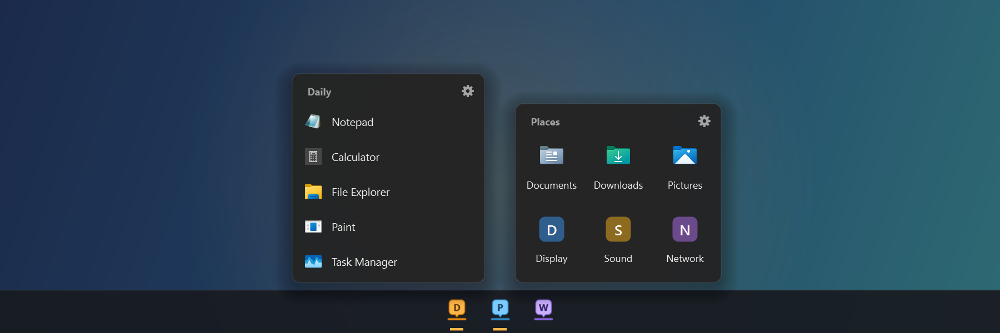
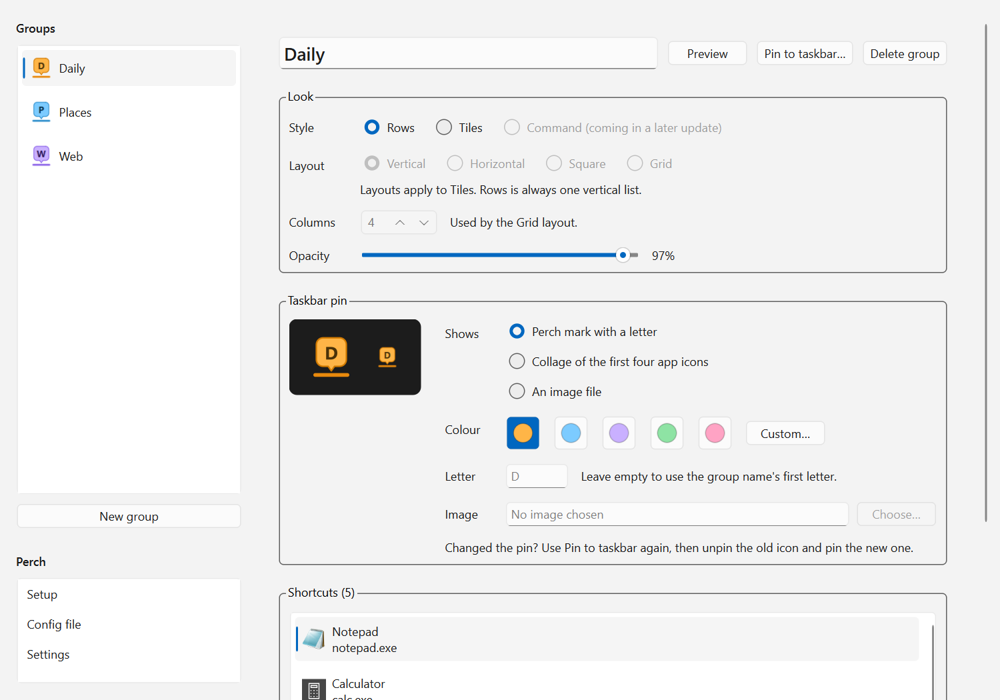

# Perch

**Group your shortcuts behind taskbar icons.** Pin a group to the Windows
taskbar, click it, and a small panel of shortcuts pops up right above it. Pick
one and the panel gets out of the way. It works like macOS Stacks or Taskbar
Groups.



> **Early preview (0.1).** Perch runs from source with Python, and there's no
> installer yet. It has been used day to day on one Windows 11 PC; see
> [Known limitations](#known-limitations) before you rely on it.

## Features

- **One taskbar icon per group.** Each group pins as its own icon, with its own
  colour and letter, an icon collage, or your own image.
- **Two styles per group.** **Rows** shows an icon and name on each line.
  **Tiles** shows large icons in a vertical, horizontal, square or grid layout.
- **Anything as a shortcut:** apps, documents, folders, web links and
  `ms-settings:` pages, with their real icons.
- **Stays out of the way.** The panel docks to the taskbar on any edge, and
  closes when you click elsewhere, press Esc, or pick a shortcut.
- **Light and dark,** following Windows or set by you, plus per-group opacity.
- **Perch Settings,** a window for editing everything, including dragging files
  in from Explorer. Changes save as you make them.
- **A plain JSON config,** if you'd rather edit by hand. Mistakes are reported
  with where and why, and Perch never overwrites a file it couldn't read.
- **Local only.** No network access, no telemetry. Everything lives in
  `%APPDATA%\Perch`.

## Install

You need Windows 10 or 11 and [Python](https://www.python.org/downloads/) 3.11
or newer.

1. Download this repository: the green **Code** button > **Download ZIP**, then
   extract it, or `git clone` it. Put it somewhere it can stay, because the
   taskbar pins point into this folder.
2. Open PowerShell in that folder and run:

   ```powershell
   python -m venv .venv
   .\.venv\Scripts\python.exe -m pip install -r requirements.txt
   .\.venv\Scripts\python.exe -m perch
   ```

The first run creates `%APPDATA%\Perch\config.json` with two sample groups and
opens the first one above the taskbar.

## Pin a group to the taskbar

Windows doesn't let apps pin themselves, so this takes one right-click:

1. Open Perch Settings (the **gear** on any panel), choose a group and press
   **Pin to taskbar…**. A shortcut for the group appears on your desktop.
2. Right-click the shortcut and choose **Pin to taskbar**. On Windows 11 you
   may need **Show more options** first.
3. Delete the desktop shortcut if you like; the pin keeps working.

Renaming a group keeps its pin working. After changing a group's pin icon,
press **Pin to taskbar…** again, then unpin the old icon and pin the new one.

## Perch Settings



Open it with the gear on any panel or with `python -m perch --settings`. You can
also add it to the Start menu from the **Setup** page.

| Page | What's there |
|---|---|
| **A group** | Name, Preview, Pin to taskbar, Delete. **Look:** style, layout and columns (Tiles), opacity. **Taskbar pin:** mark and letter, app collage, or an image file, in five colours or any colour. **Shortcuts:** add apps, files, folders or web links (or drag files in from Explorer), reorder by dragging, edit names, targets and icons. |
| **New group** | Adds an empty group. Drag groups to reorder them; the first one opens when no group is named. |
| **Setup** | Which groups are pinned, a desktop shortcut for each, and the Start menu entry. |
| **Config file** | Open in Notepad, Show in folder, Reload, Back up and Restore. |
| **Settings** | Theme (follow Windows, light or dark) and whether panels show the group's name. |

If you edit `config.json` by hand while Perch Settings is open, your changes
appear when you switch back to the window.

## Command line

`python` here means the project's own Python, `.\.venv\Scripts\python.exe`.

| Command | What it does |
|---|---|
| `python -m perch` | Show the first group |
| `python -m perch --group Work` | Show a group, by name (any capitalisation) or id |
| `python -m perch --settings` | Open Perch Settings (add `--group Work` to open at that group) |
| `python -m perch --create-shortcut Work` | Put a "Perch - Work" shortcut, with the group's pin icon, on the desktop |
| `python -m perch --config PATH` | Use a different config file (works with all of the above) |

## Config file

Perch Settings covers everything, but the file at `%APPDATA%\Perch\config.json`
is meant to be readable too:

```json
{
  "version": 1,
  "settings": {"theme": "system", "show_header": true},
  "groups": [
    {
      "id": "work-3f2a91c0",
      "name": "Work",
      "style": "tiles",
      "layout": "grid",
      "columns": 4,
      "opacity": 0.95,
      "pin": {"kind": "mark", "color": "violet", "letter": "W"},
      "shortcuts": [
        {"name": "Notepad", "target": "notepad.exe"},
        {"name": "Documents", "target": "%USERPROFILE%\\Documents"},
        {"name": "Qt docs", "target": "https://doc.qt.io/qtforpython-6/", "icon": "C:\\Icons\\qt.png"}
      ]
    }
  ]
}
```

| Key | Values | Default |
|---|---|---|
| `settings.theme` | `system`, `light`, `dark` | `system` |
| `settings.show_header` | `true`, `false` | `true` |
| `id` | 1–64 lowercase letters, digits and dashes. It never changes, so pins survive renames. | Made from the name the first time |
| `style` | `rows`, `tiles` | `rows` |
| `layout` | `vertical`, `horizontal`, `square`, `grid` (Tiles only; Rows is always one list) | `vertical` |
| `columns` | 1–12, for `grid` | 4 |
| `opacity` | 0.1–1.0 | 0.97 |
| `pin.kind` | `mark` (Perch mark with a letter), `collage` (first four app icons), `file` (your own image) | `mark` |
| `pin.color` | `amber`, `blue`, `violet`, `green`, `pink`, or any `#RRGGBB` | `amber` |
| `pin.letter` | One or two characters | The group name's first letter |
| `pin.file` | An `.ico` (used as is) or `.png` (converted), for `kind: file` | — |
| shortcut `icon` | An `.ico`, `.png` or `.exe` to take the icon from | The target's own icon |

- A `target` is anything you could open from the Run dialog: a program, a
  `.lnk`, a folder, a document, a URL, or an `ms-settings:` page. `%VARIABLES%`
  and `~` are expanded.
- Targets with no file behind them (URLs, `ms-settings:`) get a coloured letter
  tile unless you set `icon`.
- Group names (ignoring case) and ids must be unique. Groups can be empty.
- Unknown keys are ignored, so `"note": "..."` works as a comment.
- Backslashes in JSON paths are doubled: `C:\\Tools`.

## Known limitations

- **Tested on one setup.** Perch has been used on Windows 11 with one monitor
  at 150% scaling and a bottom taskbar that auto-hides. Other taskbar positions,
  an always-visible taskbar, multiple monitors and Windows 10 are covered by
  automated tests only. Reports from other setups are very welcome.
- **Runs from source.** Pins start `pythonw.exe` from the project's `.venv`, so
  they stop working if you move or delete the folder. Make them again from the
  Setup page after moving it.
- **No background mode yet.** Each click starts Perch fresh, which takes about
  a third of a second. There are no global hotkeys or tray icon yet.

## Uninstall

1. Unpin the groups from the taskbar.
2. If you added Perch Settings to the Start menu, remove it on the Setup page.
3. Delete the project folder and `%APPDATA%\Perch`.

## Roadmap

- Background mode: a tray icon, a single running copy, and global hotkeys to
  open a group
- A third style, **Command**: type to filter, number keys to launch
- Launch errors shown as notifications
- A standalone `.exe` and an installer, so Python isn't needed

## Development

```powershell
.\.venv\Scripts\python.exe -m pip install -r requirements-dev.txt
.\.venv\Scripts\python.exe -m pytest
```

Tests run on Qt's offscreen platform and fake every launch, so no window opens
and no app starts. They cover panel placement on every taskbar edge, both
styles, config validation and its error messages, icon and `.ico` output,
shortcut files, every edit Perch Settings can make, and the settings window
itself.

Perch is built with [Qt for Python (PySide6)](https://doc.qt.io/qtforpython-6/)
and [pywin32](https://github.com/mhammond/pywin32).

<details>
<summary>Project layout</summary>

```
perch/
├── __main__.py      python -m perch
├── app.py           command line, startup, error dialogs
├── models.py        Shortcut / Group / Pin / Settings / Config dataclasses (no Qt)
├── config.py        config.json: defaults, validation, atomic save
├── editing.py       every change Perch Settings makes, as pure functions
├── store.py         the settings window's live config: autosave, reload, backups
├── actions.py       desktop and Start menu shortcuts
├── palette.py       brand and pin colours (no Qt)
├── layouts.py       tile grid shapes
├── icons.py         Perch mark, group pins, .ico export, shortcut icons
├── launcher.py      opening a shortcut's target
├── pinning.py       shortcut files with their own app ID; reading what's pinned
├── taskbar.py       taskbar edge detection and panel placement
├── win32.py         ctypes: taskbar query, foreground workaround
└── ui/
    ├── panel.py     the frameless panel, gear, focus-loss dismissal
    ├── views.py     the Rows and Tiles styles
    ├── theme.py     light and dark stylesheets
    └── settings/    Perch Settings: window, group page, other pages, dialogs
tests/               pytest, offscreen
```

</details>

<details>
<summary>How it works</summary>

**Placement.** The taskbar's edge comes from comparing the monitor's full
geometry with its work area: the taskbar is the strip that's missing. When
nothing is missing (the taskbar auto-hides), Perch asks the shell through
`SHAppBarMessage`. The panel sits 8 px off the taskbar, centred on the pointer
and kept on screen. Tiles that wouldn't fit across the screen wrap onto more rows.

**Dismissal.** The panel is a frameless `Tool` window (no taskbar button, no
Alt+Tab entry) that hides as soon as it stops being the active window. If
Windows' focus-stealing guard refuses to activate it, Perch retries with the
`AttachThreadInput` workaround so the panel can't get stuck open.

**Per-group pins.** Windows treats every shortcut to the same program as one
app, so each group's shortcut carries its own AppUserModelID
(`Perch.Group.<id>`), written through pywin32. The Setup page reads the same
property from Windows' pinned-shortcuts folder to tell which groups are pinned.

**Perch Settings.** Every change is a pure function that returns a new config or
raises an error with a message for the user. A store applies it, refreshes the
pages and saves 300 ms after the last change. All dialogs live in one module, so
tests replace them and drive the real window without anything modal opening.

</details>

## Licence

[MIT](LICENSE)
